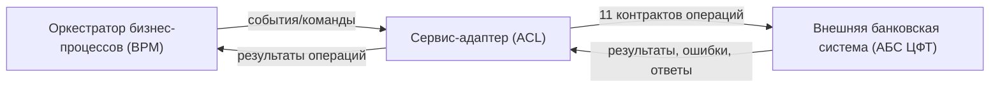

# Проект 3. Событийная интеграция с банковской системой: 11 контрактов

> Финтех · роль: системный аналитик (контракты и модель обмена) · проект под NDA, названия обезличены

## Контекст

Три системы должны обмениваться событиями и операциями: **оркестратор бизнес-процессов (исполняемая BPMN-схема)**, **сервис-адаптер (ACL)** и **внешняя банковская система заказчика (АБС ЦФТ)**. Обмен — событийный, через Kafka; операции — бинарные (успех/ошибка) с полным жизненным циклом.

## Задача

Спроектировать контрактный слой интеграции + полное описание сервиса: контракты всех операций, маппинги данных, единую модель обработки ошибок, правила трансформации данных, и провести аудит уже написанных спецификаций команды банка.

## Архитектура обмена



## Что сделал

1. **11 интеграционных контрактов** (AsyncAPI 3.0, JSON Schema + текстовые спецификации) для событийного обмена по Kafka — по одному на каждую бизнес-операцию, с версионированием и CHANGELOG
2. **Единая модель обработки ошибок для 11 операций**:
   - каталоги кодов ошибок по каждой операции
   - **правила идемпотентности** (ключи операций, поведение при повторе)
   - гарантия согласованной доставки (**outbox**)
   - **стратегия DLQ** + процесс разбора
   - обработка **неопределённых и поздних ответов** (таймаут ≠ отказ: перезапрос статуса у исполнителя)
3. **Contract-first на практике**:
   - маппинги полей между тремя системами (сквозной реестр **150+ параметров**)
   - правила валидации и трансформации форматов
   - **автоматическая проверка примеров сообщений против схем** — все контракты валидировались до передачи в разработку
4. **Аудит спецификаций команды банка**: сверка независимо написанных описаний одного и того же обмена → **реестр 19 расхождений** с приоритизацией P0/P1/P2, отчёт доработок, бэклог вопросов к внешнему партнёру с готовыми решениями
5. **Тест-кейсы**: позитивные/негативные, минимальные обязательные наборы, граничные значения; диаграммы последовательности (Mermaid) и таблицы решений
6. **Спецификация сервиса** с полным описанием механизма работы и назначения сервиса для передачи заказчику.

## Пример обезличенного фрагмента контракта операции

```yaml
asyncapi: 3.0.0
info:
  title: Операция "Изменение статуса объекта" (обезличено)
channels:
  partner.events.v1:
    address: partner.events.v1
    messages:
      objectStatusChanged:
        payload:
          type: object
          required: [external_id, status, occurred_at]
          properties:
            external_id: { type: string, maxLength: 50 }
            status: { type: string, enum: [ACTIVE, DELINQUENT, CLOSED] }
            occurred_at: { type: string, format: date-time }
operations:
  onObjectStatusChanged:
    action: receive
    channel: partner.events.v1
```

## Результат

- 11 контрактов в проде, единая модель ошибок закрыла «неописанные сценарии», которые до этого всплывали на стыке команд
- Аудит документации команды банка
- Автопроверка схем стала практикой команды (контракты больше не расходились с примерами)

## Технологический стек:
Apache Kafka, AsyncAPI 3.0, JSON Schema, outbox, DLQ, идемпотентность, версионирование контрактов, Python (валидация), Mermaid, Redpanda, Offset Explorer, VS Code, GitLab