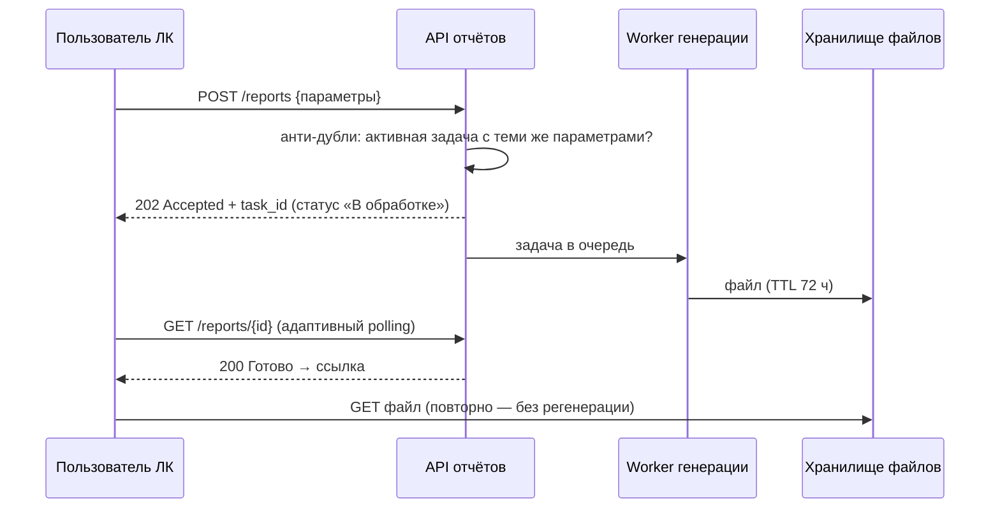

# Проект 1. Реализация выгрузки Excel-отчётов для аналитического дашборда личного кабинета

> Финтех, SaaS-платформа кредитования · роль: системный аналитик (полный цикл — от требований до приёмки) · проект под NDA, детали обезличены

## Контекст

Личный кабинет клиента платформы содержит дашборд воронок (конверсия по шагам процессов). Пользователям-тенантам (десятки организаций) нужны выгрузки в Excel для удобства проведения аналитики.

## Задача

Спроектировать функционал выгрузки Excel-отчётов из дашборда: от сбора требований до ТЗ для frontend- и backend-команд.

## Моя роль и что сделал

1. **Обследование микросервиса аналитики**: реверс-инжиниринг и документирование **16+ REST API методов** (realtime/ретро-срезы, детализация с пагинацией, мульти-тенантность, авторизация по заголовку)
2. **Анализ модели данных MySQL**: рабочие таблицы процессов и взаимодействий, JSON-колонки с клиентскими атрибутами; составил маппинг полей отчётов на таблицы БД
3. **Проектирование API-контракта** доработки существующих эндпоинтов (параметризация) и новых методов
4. **НФТ и защита от перегрузки**: TTL 72 ч на файлы, анти-дубли запросов, троттлинг, квоты на тенанта
5. **Описание 2 видов Excel-отчётов** (включая воронку метрик конверсии): формулы расчёта показателей, словарь локализации шагов EN→RU, проработка и согласование набора полей отчетов
6. **ПДн**: белый список полей, маскирование, соответствие 152-ФЗ
7. **Процесс**: протокол решений, реестр открытых вопросов, критерии приёмки; итоговое ТЗ (Markdown), описание микросервиса и методов (Confluence).

## Ключевое решение: Async Request-Reply вместо синхронного отчёта

Диаграмма последовательности:

Статусная строка с информацией по генерации отчетов реализована через адаптивный polling.

- после успешной отправки формы — инвалидация кэша списка и немедленный refetch;
- если в списке есть `pending`-записи — опрос списка каждые **7 секунд**;
- готовые записи — фоновое обновление раз в **60 секунд**;
- при опустошении `pending`-списка — принудительный однократный refetch;
- при пустом `pending`-списке агрессивный опрос отключается.

## Результат

- 2 вида отчётов в проде (метрики и процессы) по 3 разным процессам, включая воронку конверсии по шагам процессов
- Полное ТЗ (структура: требования → НФТ → модель данных → контракты REST API → критерии приемки → приёмка) 
- Защита от перегрузки (квоты/троттлинг/TTL) спроектирована до старта разработки
- Реализация через микросервисную архитектуру, используя обогащение данных через обращение к финансовому ядру

## Технологический стек:
REST API, MySQL, JSON, async request-reply, polling, Confluence, Jira, Markdown
