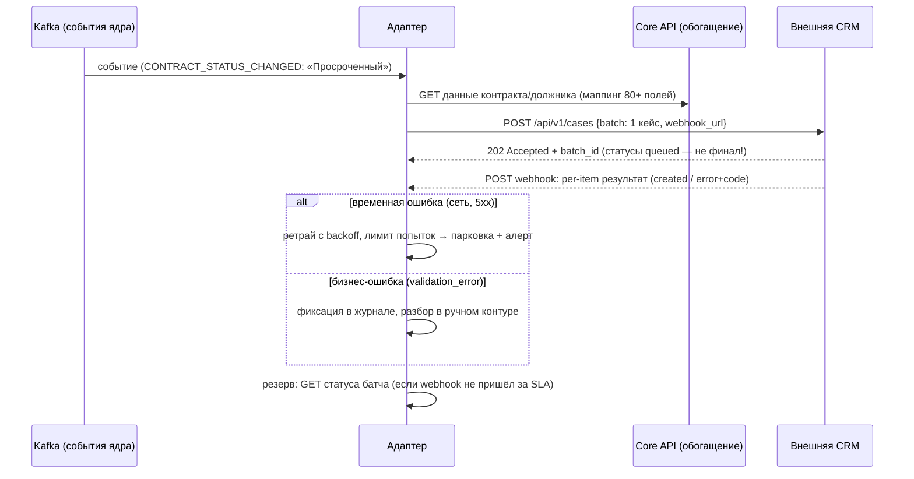

# Проект 2. Событийная интеграция с коллекторской CRM

> Финтех, SaaS-платформа кредитования · роль: системный аналитик (полное ТЗ интеграции) · проект под NDA, названия обезличены

## Контекст

Платформа должна передавать просроченную задолженность во **внешнюю коллекторскую CRM**: контракты (кейсы), платежи, смены статусов. Внешняя сторона принимает только REST; внутенние события используют Kafka.

## Задача

Спроектировать событийно-ориентированную интеграцию «ядро платформы → внешняя CRM»: полный цикл — триггеры, контракты, транспорт, обработка ошибок, идемпотентность, мониторинг.

## Решение: Kafka → адаптер → REST, с асинхронным подтверждением

Вместо прямого «Kafka-консюмер пишет в CRM» — выделенный **сервис-адаптер**, который: фильтрует события по бизнес-условиям, обогащает данные обратными вызовами к ядру (REST), трансформирует форматы, батчит и отправляет.

**8 типов обрабатываемых событий** (контракт исходящего топика ядра):

| Событие | Условие обработки |
|---|---|
| CONTRACT_STATUS_CHANGED | статус IN («Просроченный», «Реструктурированный просроченный») |
| CONTRACT_CLOSE | статус закрытия = «Закрыт по цессии» |
| CONTRACT_PROLONGATION | пролонгация контракта |
| CONTRACT_NEW_SCHEDULE | новый график (кредитные каникулы и др.) |
| FUNDTRANSACTION_SAVE | платёж по контракту |
| CONTRACT_BALANCE_CHANGED / CONTRACT_BALANCE_CHANGE_ROLLBACK | snapshot-ы баланса |
| CONTRACT_REPAYMENT_ROLLBACK | откат платежа |

## Ключевые решения

1. **Async Request-Reply**: HTTP 202 + batch_id + webhook с per-item статусами — CRM не создаёт сущности мгновенно, финал приходит колбэком
2. **Идемпотентность** по бизнес-ключам: `external_case_id` / `external_payment_id`; повтор с полным совпадением → «безопасный дубль» (успех), с расхождением → «конфликт» (ошибка отправителя) — задвоение передачи исключено
3. **Малые батчи** («1 батч = 1 сущность») — осознанный trade-off: granular per-item статусы и простая диагностика вместо throughput
4. **Каталог кодов ошибок**: валидация полей (по каждому полю!), «кейс уже существует», «конфликт платежа», «кейс не найден» — каждый код имеет владельца и маршрут (автоповтор / ручной разбор)
5. **Мониторинг**: корреляция external_id + batch_id; резервный опрос статусов при потерянном webhook

## Эволюция контракта (прод)

Контракт исходящего события изменялся: за время проекта добавлены обработка смен статусов, новые поля и роуты обогащения, ужесточена валидация (номера телефонов) — все изменения проводились через версионирование и CHANGELOG без поломки потребителей.

## Результат

- Полное ТЗ (13 разделов): триггеры, контракты, транспорт, ошибки, идемпотентность, НФТ, приёмка; маппинг **80+ полей** на **15+ методов** REST API ядра
- ER-модель сервиса-адаптера и сервисные API контроля статусов (кейс/платёж/батч)
- Интеграция в проде, эволюция контракта через версии

## Технологический стек:
 Apache Kafka, REST API (HTTPS, JSON, API Key/Bearer), webhook, идемпотентность, backoff, JSON-схемы, draw.io, Confluence