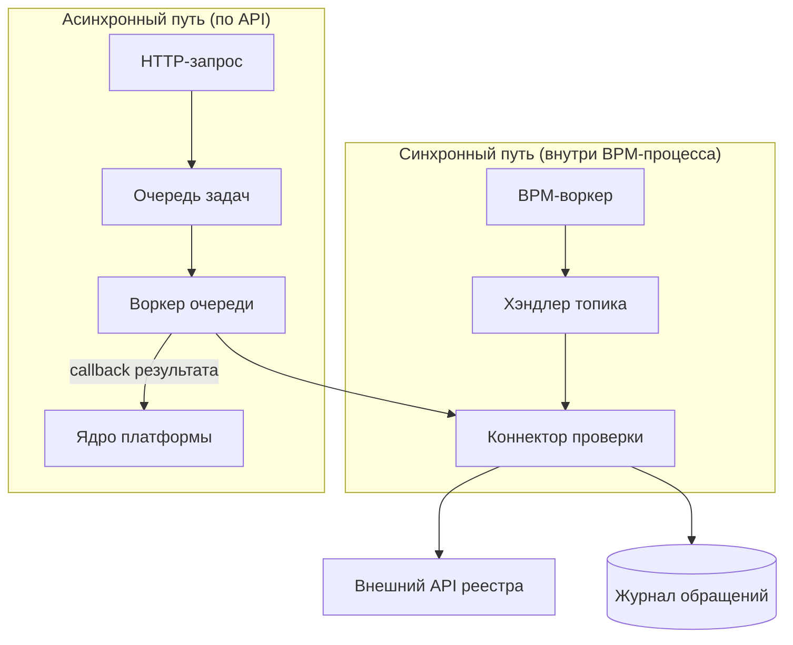

# Проект 4. Микросервис комплаенс-проверок кредитного конвейера

> Финтех · роль: системный аналитик — **спроектировал и описал контракты (коннекторы) шести проверок** · проект под NDA, названия обезличены

## Контекст

Кредитный конвейер (BPM-движок) перед выдачей проверяет заёмщиков по внешним государственным реестрам через агрегатора данных.

## Задача

Спроектировать контракты шести проверок-коннекторов: вход, вызов внешнего API, разбор ответа, агрегация, рекомендация, ошибки.

## Шесть контрактов

| # | Проверка | Внешний источник | Вход → результат |
|---|---|---|---|
| 1 | ИНН физлица | ФНС | ФИО + паспорт → ИНН |
| 2 | Статусы ФЛ: самозанятость, ИП, дисквалификация, банкротство | ФНС | ИНН → статусы |
| 3 | Исполнительные производства ФЛ | ФССП | ФИО + дата рождения → список ИП (все страницы) |
| 4 | Исполнительные производства ЮЛ | ФССП | ИНН → список ИП (все страницы) + рекомендация |
| 5 | Блокировки счетов (решения ФНС) | ФНС | ИНН → действующие приостановления операций |
| 6 | Участия в арбитражных делах | Арбитражи | ИНН → роли (истец/ответчик/третье лицо), все страницы |

## Архитектура: два режима работы одного коннектора



Синхронный путь — проверки внутри BPMN-процесса (хэндлер топика). Асинхронный — приём HTTP-запроса, постановка в очередь, **мгновенный 200 без тела**, результат возвращается в ядро callback'ом из воркера. Каждое обращение к внешнему API журналируется.

## Сквозные решения всех контрактов

1. **Fallback-резолвинг параметров**: необязательные входы (ФИО, ИНН, дата рождения) добираются из данных лида через Core API — контракты устойчивы к «прислали минимум»
2. **Пагинация внешних ответов**: обход всех страниц (`next_page`), объединение в единый список — результат проверки всегда полный
3. **Политика ошибок**: сетевые ошибки и 5xx → ретраи (настраиваемый лимит); 4xx → «as is» как бизнес-результат без ретрая
4. **Безопасность**: API-ключ только из хранилища секретов — запрещён во входных параметрах, логах, job-результатах и отчётах
5. **Рекомендация для скоринга**: нет записей → `APPROVE`; найдены → `DENY` с агрегированными данными; «не найден объект» → отдельный BPMN-код ошибки, а не «успех без данных»

## Формат контракта (пример структуры, обезличено)

Каждый из 6 контрактов описан по единой структуре:

```
1. Общая информация     — название, код, топик, объект, внешний источник, env-флаг
2. Входные параметры    — таблица: параметр / тип / обязательность /
                          fallback («если не передано — из данных лида»)
3. Внешний запрос       — метод, адрес, query-параметры и их источники
4. Ожидаемые ответы     — все ветки: с данными / без данных / ошибка (JSON)
5. Алгоритм             — шаги, пагинация, агрегация, рекомендация
6. Обработка ошибок     — ретраи, коды, BPMN-ошибки
```

## Результат

- 6 контрактов-коннекторов приняты командой разработки и работают в проде в двух режимах (sync/async)
- Единый формат контрактов сократил время описания новых проверок (проверка добавляется «по образцу»)

## Технологический стек:
REST API, BPMN-интеграции, очереди задач, пагинация, ретраи, JSON, Confluence, Jira